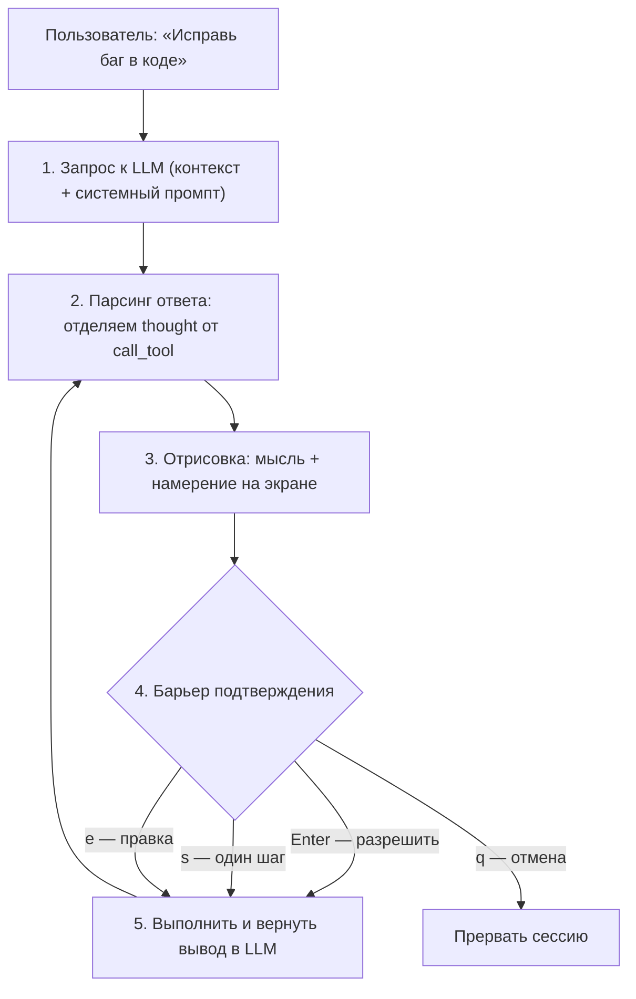

# IntellectHub Client — цикл агента «Мысль → Действие → Проверка»

Это проектный документ: как должен работать консольный клиент IntellectHub, чтобы сочетать автономность Claude Code и прозрачный пошаговый контроль Hermes Console. Реализация сверяется с этим файлом.

## Зачем

«Слепые» агенты уходят в бесконечные циклы или выполняют опасные команды (`rm -rf`) без ведома пользователя. Защита — жёстко разделять **внутренний диалог модели** и **визуализацию для человека**, вставляя интерактивный барьер перед каждым действием.

## Цикл



## 1. Формат вывода модели

Модель обязана отвечать блоками, которые приложение парсит.

```xml
<thought>
Что понял из задачи, какой файл хочет прочитать и почему.
</thought>

<call_tool name="bash">
  <arg name="command">npm test</arg>
</call_tool>
```

Правила для модели (см. системный промпт ниже): одно действие за шаг, обязательный `<thought>` перед вызовом, вызов строго в `<call_tool>`.

## 2. Консольный UI

Получив ответ, приложение **не запускает команду сразу**, а рисует дашборд в терминале:

- **МЫСЛЬ (Thought)** — серым/синим. Пользователь видит, почему агент принял решение.
- **НАМЕРЕНИЕ (Action)** — ярким цветом (жёлтый). Явно пишется, что именно и где будет выполнено:
  ` Агент хочет запустить: npm test в папке /project`
- **Барьер (Инспекция)** — скрипт замирает и ждёт ввод:
  - `[Enter]` — разрешить действие; агент выполняет и читает вывод.
  - `[s]` — выполнить только одну команду, если их несколько (шаг).
  - `[e]` — отредактировать команду руками перед запуском (модель ошиблась со слэшем или флагом).
  - `[q]` — прервать сессию.

Этот барьер — единственное место, где выполнение команд останавливается. Всё остальное — отрисовка и парсинг.

## 3. Аккуратный вывод (без мусора)

Чтобы консоль не превращалась в кашу из сотен строк (как у Aider):

1. **Сворачивание вывода инструментов** — на экран первые 5 и последние 5 строк, полный вывод уходит в контекст модели.
2. **Спиннер статуса** — пока модель думает, крутится анимированный индикатор (`⏳ Агент анализирует проект…`) с таймером, чтобы было видно, что процесс не завис.
3. **Лог сессии в Markdown** — все «мысли» и «команды» дублируются в локальный файл `.agent_log.md`, чтобы историю можно было открыть глазами после закрытия консоли.

## 4. Системный промпт агента

Базовый контекст для модели (передаётся в `system`):

```text
Ты — автономный инженерный AI-агент, работающий в консоли.
Твоя цель — решать задачи пользователя, пошагово вызывая инструменты
(чтение файлов, запись файлов, выполнение Bash-команд).

ПРАВИЛА ВЗАИМОДЕЙСТВИЯ:
1. Каждое твое действие должно быть абсолютно прозрачным для пользователя,
   который наблюдает за консолью.
2. Перед вызовом любого инструмента ты ОБЯЗАН объяснить пользователю свою
   логику в теге <thought>. Пиши кратко, по делу, на русском языке
   (например: «Исправляю ошибку импорта в index.js, для этого нужно
   перезаписать файл»).
3. Сам вызов инструмента делай строго в тегах <call_tool>.
4. Не пытайся выполнить несколько опасных или не связанных действий за один
   шаг. Делай один шаг — получай результат — планируй следующий.
5. Если команда завершилась ошибкой (сломался синтаксис, не туда слэш),
   не паникуй. Проанализируй вывод терминала, признай ошибку в <thought>
   и предложи исправленный вариант.
```

## 5. Соответствие текущему коду

Текущий клиент уже даёт каркас цикла, но без XML-протокола и барьера подтверждения.

| Что нужно | Где сейчас |
|---|---|
| Цикл шагов агента | `IntellectHub.Client/Program.cs`, `RunTurnAsync()` |
| Отрисовка экрана и спиннер | `IntellectHub.Client/Screen.cs` (`Busy`/`Idle`, кадры `·✢✳✶✻✽`) |
| Логотип и баннер | `IntellectHub.Client/Banner.cs` |
| Инструменты `read`/`write`/`glob`/`bash` | `IntellectHub.Client/Tools.cs` |
| Отправка/парсинг ответа | `IntellectHub.Client/ApiClient.cs` (`SendAsync`, `ParseReply`) |

Чего пока нет и что добавляем на следующих этапах:

- парсер `<thought>` / `<call_tool>` и режим вывода модели под этот протокол;
- барьер подтверждения `[Enter]/[s]/[e]/[q]` перед выполнением инструмента в `RunTurnAsync()`;
- сворачивание вывода инструментов (первые/последние 5 строк) при показе;
- запись лога сессии в `.agent_log.md`.
